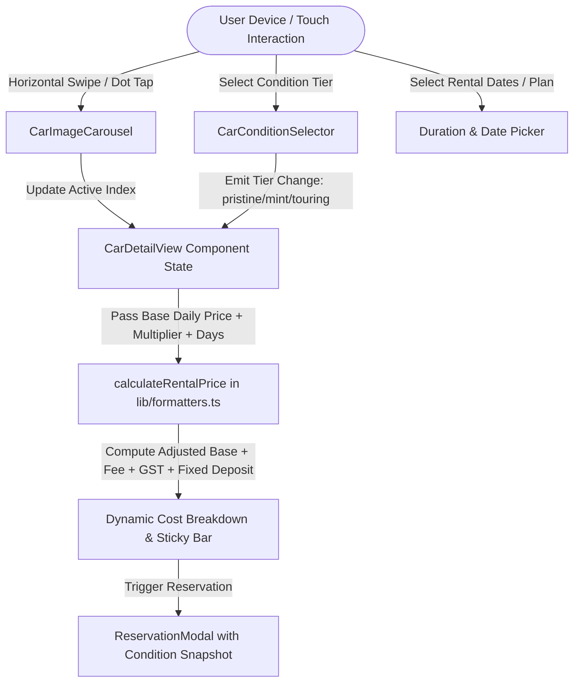

# Homie Drives — Mobbin Layout, Indian Fleet Expansion & 3-Tier Condition Pricing

* **Author:** Antigravity Engineering
* **Status:** Implemented & Verified (Mobbin Visual Polish, DigiLocker Checkout, Trip Planner, and Live Digital Pass Keyless Sync)
* **Date:** 2026-10-31

--------------------------------------------------------------------------------

## Overview

This feature updates the customer vehicle detail and fleet discovery experience by integrating layout patterns from the Mobbin reference design (atmospheric hero media, floating summary sheets, horizontal detail cards, and pill-based controls), introducing a swipeable multi-angle car image carousel, expanding the fleet with high-demand Indian market vehicles, and adding an interactive 3-tier vehicle condition selector with real-time dynamic price recalculation.

--------------------------------------------------------------------------------

## The Problem

1. **Static Imagery Limits Inspection**: The current vehicle detail page displays a single image view with manual button toggles. Prospective renters cannot fluidly swipe through exterior angles, cockpit views, and rear details on touch devices.
2. **Exclusive Exotic Bias Dilutes Delhi NCR Market Relevance**: The initial fleet heavily emphasized imported supercars (Aston Martin, Ferrari, Urus). Real-world Delhi NCR rental demand is dominated by capable domestic SUVs and EVs (Mahindra Thar Roxx, Scorpio-N, Tata Nexon EV, Toyota Innova HyCross) suitable for local traffic, NCR road conditions, and regional weekend getaways.
3. **Binary Pricing Ignores Fleet Age & Wear**: Currently, vehicle prices are static per model regardless of vehicle vintage or odometer reading. In operational reality, a brand-new vehicle with 2,000 km warrants a premium rate, while a mechanically sound 45,000 km vehicle should be accessible at a discounted rate for budget-conscious road trips.
4. **Desktop-Centric Information Density**: Detail pages require excessive vertical scrolling to reach specifications and pricing breakdowns, diverging from modern mobile-first applications that utilize floating overlay cards and horizontal sliding spec sheets.

--------------------------------------------------------------------------------

## Goals

* **Mobbin-Inspired Mobile Architecture**: Re-architect the vehicle detail view (`/cars/[slug]`) and fleet cards using layout patterns from the reference: full-bleed top media hero, floating frosted summary card, horizontal scrolling specification blocks, and a clean bottom action bar.
* **Touch-Native Image Carousel**: Implement a responsive, swipeable image carousel with pagination indicators, touch drag gestures, and thumbnail navigation for all vehicle angles.
* **Domestic Indian Fleet Additions**: Add typed demo listings for high-demand Indian vehicles (Mahindra Thar Roxx 4x4, Tata Nexon EV Long Range, Mahindra Scorpio-N 4Xplor, Toyota Innova HyCross Hybrid) with authentic specs, Delhi NCR hub allocations, and realistic daily rates (₹2,499–₹6,999/day).
* **3-Tier Vehicle Condition Engine**: Add an interactive condition selector providing three clear grades:
  - **Pristine / Showroom**: < 5,000 km, zero cosmetic wear, factory delivery finish (+15% price adjustment).
  - **Executive Mint (Standard)**: 5,000–25,000 km, fully detailed, certified flawless mechanicals (Base price / 1.0x).
  - **Touring / Value**: 25,000–60,000 km, minor road patina, mechanically certified for long highway drives (-15% price adjustment).
* **Deterministic Price Recalculation**: Dynamically recalculate daily rates, GST (18%), service fees, refundable security deposits, and estimated totals when the user toggles between condition tiers.

--------------------------------------------------------------------------------

## Non-Goals

* **Live Inventory Telemetry Synchronization**: Actual OBD-II odometer tracking or live damage report databases will not be connected in this phase.
* **Real Return-Inspection Dispute Resolution**: Live digital check-in photo uploads or dispute workflows will not be built; the UI will document the policy clearly to prevent customer confusion.
* **Arbitrary Condition Slider**: The condition selector will be restricted to three standardized discrete tiers rather than a continuous slider to prevent unmanageable pricing granularity.
* **Arbitrary Fleet Sourcing**: Customers cannot list their personal vehicles; all vehicles remain managed by Homie Drives and assigned agents.

--------------------------------------------------------------------------------

## Open Questions & Architectural Risks

* **Risk 1 (Return-Time Wear Disputes)**: When customers choose the "Touring / Value (-15%)" tier, what prevents them from being unfairly penalized for pre-existing scratches during return inspection? *Mitigation: The design must incorporate an explicit Pre-Trip Digital Condition Certificate display showing pre-existing marks.*
* **Risk 2 (Fleet Segmentation Dilution)**: How should Indian mass-market touring vehicles coexist with exotic hypercars without diluting the platform's premium positioning? *Mitigation: Group listings by distinct fleet collections ("Heritage & Adventure", "Urban Electric", "Executive Limousines", "Crown Supercars").*
* **Risk 3 (Dynamic Deposit Adjustments)**: Does the refundable security deposit scale with condition tier, or remain fixed per vehicle class? *Mitigation: Standardize security deposits by vehicle category rather than condition tier to keep deposit calculations transparent.*

--------------------------------------------------------------------------------

## Critical User Journeys (CUJs)

### CUJ 1: Exploring Multi-Angle Imagery via Carousel
* **Given**: A user is browsing a vehicle detail page (`/cars/mahindra-thar-roxx`) on a mobile screen.
* **When**: The user swipes horizontally across the hero image area or taps pagination indicator dots.
* **Then**: The carousel slides smoothly to the next image (Exterior Profile → Cockpit Interior → Rear Angle → Cargo Bay), updating the active counter chip without page layout shift.

### CUJ 2: Selecting Vehicle Condition & Inspecting Price Differential
* **Given**: A customer is viewing the Aston Martin Vantage V8 priced at base ₹22,499/day for Executive Mint.
* **When**: The customer selects "Pristine / Showroom (+15%)" on the condition selector.
* **Then**: The daily rate updates instantly to ₹25,874/day, the itemized breakdown recalculates base hire, service fee, and GST, and a condition badge confirms "Zero cosmetic wear • < 5,000 km".

### CUJ 3: Filtering & Booking Indian Adventure Fleet
* **Given**: A user wants to rent a 4x4 vehicle for a trip from Delhi to Rishikesh.
* **When**: The user navigates to `/plan?tab=cars` and filters by "Mahindra" or "Touring SUV".
* **Then**: The Mahindra Thar Roxx and Scorpio-N appear with clear condition badges, accurate INR daily pricing, and assigned Delhi NCR hub locations.

--------------------------------------------------------------------------------

## Technical Plan (Architecture)

### 1. Component Architecture & Structural Mapping

The vehicle presentation architecture is decomposed into focused, reusable modules:

```text
src/
├── components/
│   ├── cars/
│   │   ├── CarImageCarousel.tsx       [NEW] Swipeable touch carousel with pagination dots & thumbnails
│   │   ├── CarConditionSelector.tsx   [NEW] 3-tier condition grade selector with delta badges
│   │   ├── CarDetailView.tsx          [MODIFY] Rebuilt with Mobbin layout primitives
│   │   └── CarCard.tsx                [MODIFY] Displays condition availability tags & Indian brands
│   └── booking/
│       └── ReservationModal.tsx       [MODIFY] Preserves chosen condition grade & audit record
├── data/
│   └── cars.ts                        [MODIFY] Indian vehicle models + multi-angle galleries + condition options
├── lib/
│   └── formatters.ts                  [MODIFY] Condition-aware price calculation engine
└── types/
    └── car.ts                         [MODIFY] VehicleConditionTier interfaces & schema
```

### 2. Data Flow Diagram



### 3. Data Models & Type Extensions (`src/types/car.ts`)

```typescript
export type VehicleConditionTier = "pristine" | "mint" | "touring";

export interface VehicleConditionOption {
  tier: VehicleConditionTier;
  label: string;
  odometerRange: string;
  cosmeticDescription: string;
  priceMultiplier: number; // e.g. 1.15 for pristine, 1.0 for mint, 0.85 for touring
  inspectionStatus: string;
}

export interface Car {
  // Existing fields preserved...
  conditionOptions?: VehicleConditionOption[];
  defaultConditionTier?: VehicleConditionTier;
}

export interface RentalPriceBreakdown {
  days: number;
  conditionTier: VehicleConditionTier;
  conditionMultiplier: number;
  baseDailyRate: number;
  adjustedDailyRate: number;
  rentalBase: number;
  insurance: number;
  serviceFee: number;
  gst: number;
  securityDeposit: number;
  total: number;
}
```

### 4. Layout Architecture (Mobbin-Inspired Transformation)

* **Hero Media Canvas**: Full-bleed media banner with aspect-ratio preservation, touch-swipe event listeners (`onTouchStart`, `onTouchMove`, `onTouchEnd` with minimum 40px delta threshold), and translucent pagination pill overlay.
* **Floating Header Sheet**: Sits over the lower edge of the carousel with negative margin (`-mt-6 sm:-mt-8`), frosted glass effect (`bg-white/95 backdrop-blur-xl border border-white/60 shadow-homie-lg rounded-t-[32px] sm:rounded-[32px]`), car title, category badge, rating, and telematics health ribbon.
* **Interactive Condition Selector**: Positioned right above the rental calendar. Three clean cards:
  - Card 1: *Pristine (< 5k km)* • "+15% Rate" • Factory delivery finish.
  - Card 2: *Executive Mint (5k–25k km)* • "Standard Fleet" • Flawless certified.
  - Card 3: *Touring Ready (25k–60k km)* • "-15% Value" • Verified highway warrior.
* **Horizontal Specification Sliders**: Specifications presented in horizontally scrollable swipe containers with smooth snap, matching Screen 4 of the Mobbin reference.

--------------------------------------------------------------------------------

## Alternatives Considered

### Alternative 1: Continuous Mathematical Mileage Decay Curve
* **Pros**: Eliminates bracket steps by computing an exact price per individual kilometer on the odometer.
* **Cons**: Excessively complex mental model for customers; volatile price quotes; impossible for dispatchers to guarantee an exact single odometer reading in advance.
* **Reason for Rejection**: Standardized 3-tier discrete condition grades (Pristine, Executive Mint, Touring Value) provide predictability for both customer reservations and fleet turnaround operations.

### Alternative 2: Separate Catalog Listings for Each Vehicle Condition
* **Pros**: Standard e-commerce catalog pattern where each inventory item is a standalone URL.
* **Cons**: Clutters the fleet explorer with repetitive duplicates of the same vehicle model; confuses customers comparing models; fragments customer reviews and ratings across multiple slugs.
* **Reason for Rejection**: Retaining a single canonical vehicle model with an interactive in-place condition switcher provides a far cleaner discovery UX and instantaneous price comparison.

### Alternative 3: External Carousel NPM Library (Swiper / Embla)
* **Pros**: Provides pre-bundled touch physics and transition animations out of the box.
* **Cons**: Introduces 35kB+ of client bundle overhead, increases build dependency chain, and risks SSR hydration mismatch warnings in Next.js Server Components.
* **Reason for Rejection**: A zero-dependency CSS scroll-snap implementation paired with standard React pointer touch handlers achieves native 60fps mobile gestures with zero bundle bloat.

--------------------------------------------------------------------------------

## Non-Functional Requirements

* **Performance & Bundle Size**: Zero external UI dependencies; all carousel transitions execute on GPU-composited CSS transforms (`translateX`, `scroll-snap-type: x mandatory`).
* **Accessibility**: Full keyboard arrow navigation (`ArrowLeft` / `ArrowRight`) supported on both the image carousel and the condition radio cards with explicit `aria-selected` and `role="radiogroup"` semantics.
* **Responsive Robustness**: No layout shift (CLS < 0.05) when toggling between condition tiers or swiping carousel images across viewport widths from 320px to 1440px.

--------------------------------------------------------------------------------

## Detailed Implementation Plan

### Target Files to Create / Modify

#### 1. `src/types/car.ts` (Modify)
* **Rationale**: Define `VehicleConditionTier`, `VehicleConditionOption`, and `RentalPriceBreakdown` interfaces, and augment the `Car` type so condition metadata and multipliers are strongly typed across the application.

#### 2. `src/lib/formatters.ts` (Modify)
* **Rationale**: Extend `calculateRentalPrice` to accept an optional `conditionMultiplier: number` (default `1.0`), computing `adjustedDailyRate`, scaled `rentalBase`, `serviceFee` (5%), `gst` (18%), and category-fixed `securityDeposit`.

#### 3. `src/components/cars/CarImageCarousel.tsx` (Create)
* **Rationale**: Reusable mobile-first swipeable image carousel. Implements touch start/move/end handlers with 40px gesture thresholds, pagination pill indicator (`current / total`), thumbnail navigation strip, and cross-fade image rendering.

#### 4. `src/components/cars/CarConditionSelector.tsx` (Create)
* **Rationale**: 3-tier condition radio card group. Displays tier badges (*Pristine*, *Executive Mint*, *Touring Value*), odometer brackets, condition inspection tags, and price delta indicators (`+15%`, `Base`, `-15%`).

#### 5. `src/components/cars/CarDetailView.tsx` (Modify)
* **Rationale**: Restructure the layout according to Mobbin design principles:
  - Hero image area converted to full-bleed `CarImageCarousel`.
  - Floating negative-margin frosted sheet (`-mt-6`) housing title, rating, and telematics ribbon.
  - Insert `CarConditionSelector` with dynamic re-calculation of daily and total pricing.
  - Convert feature specs grid into horizontally scrollable snap cards.
  - Update inline CTA and sticky mobile bottom bar to reflect condition tier.

#### 6. `src/data/cars.ts` (Modify)
* **Rationale**: Add 4 popular Indian market vehicles:
  - **Mahindra Thar Roxx 4x4** (Adventure Off-Roader, ₹4,499/day)
  - **Tata Nexon EV Long Range** (Urban Electric, ₹2,699/day)
  - **Mahindra Scorpio-N 4Xplor** (Touring Power SUV, ₹3,899/day)
  - **Toyota Innova HyCross Hybrid** (7-Seater Luxury Lounge, ₹5,499/day)
  Provide default 3-tier condition configurations for all fleet models. Add "Tata" and "Toyota" to `BRANDS`.

#### 7. `src/components/cars/CarCard.tsx` (Modify)
* **Rationale**: Show condition availability indicator chip (`"3 Condition Grades"`) and ensure price display reflects base range with clean Mobbin badge styling.

#### 8. `src/components/booking/ReservationModal.tsx` (Modify)
* **Rationale**: Display the selected vehicle condition tier, odometer bracket, and pre-trip inspection disclaimer in the reservation preview summary.

#### 9. `public/images/cars/` (Create Asset Files)
* **Rationale**: Generate realistic studio photographic assets for the newly added Indian fleet models (exterior, cockpit, and rear perspectives).

#### 10. `README.md` (Modify)
* **Rationale**: Document the 3-tier condition pricing engine, Mobbin design principles, and expanded Indian fleet catalogue.

### Execution Sequence

1. **Phase A: Data & Types**: Update `src/types/car.ts` and `src/lib/formatters.ts`.
2. **Phase B: Asset Generation & Fleet Expansion**: Generate studio images for Indian models and update `src/data/cars.ts`.
3. **Phase C: Interactive Carousel & Condition Components**: Create `CarImageCarousel.tsx` and `CarConditionSelector.tsx`.
4. **Phase D: Mobbin Layout Refactoring**: Re-architect `CarDetailView.tsx` with floating frosted summary, horizontal cards, and sticky bar. Update `CarCard.tsx` and `ReservationModal.tsx`.
5. **Phase E: Verification & Linting**: Run `npm run lint` and `npm run build` to confirm zero errors. Test interactive carousel swipe and condition toggle via browser subagent.
6. **Phase F: Option B (Booking & DigiLocker KYC)**: Implemented 4-step reservation drawer with 3 damage protection plans (Standard, Premium Zero-Dep, VIP Super Shield), instant DigiLocker DL government authentication simulation, FASTag wallet buffer, and keyless digital pass generation.
7. **Phase G: Option C (Interactive Trip Planner & Highway Telematics)**: Implemented interactive Delhi NCR highway getaway planner (`/plan?tab=trips`) with live expressway toll & fuel calculation, round-trip vs one-way toggles, curated pitstops (dining, EV DC fast, fuel, scenic rest), and 1-click fleet matching with immediate checkout modal integration.
8. **Phase H: Live Digital Pass & Keyless Handover Sync**: Built full cross-page synchronization connecting checkout reservations directly to `/ride?tab=pass` via `useSyncExternalStore` and `localStorage`, implemented interactive Bluetooth/cellular Keyless Smart Access remote (door lock/unlock, cabin climate pre-conditioning, hazard lights locator), full-screen QR hub dispatch scanner, and government-verified DigiLocker smart card viewer on `/profile`.
