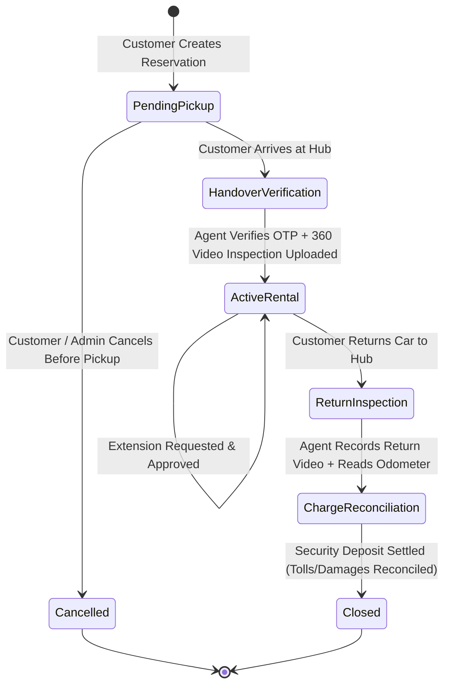

# Homie Drives — Booking & Rental Lifecycle State Machine

* **Architecture Invariant**: All critical lifecycle transitions are server-controlled, deterministic, and auditable.

---

## 1. Lifecycle State Machine

---

## 2. Transition Rules & Pre-Conditions

### Transition 1: `[*] -> PendingPickup`
* **Trigger**: Customer completes 4-Step checkout drawer (`ReservationModal.tsx`).
* **Pre-conditions**:
  * Vehicle operational status is `active`.
  * Date range does not conflict with existing active reservations (`btree_gist` constraint).
  * DigiLocker DL number is provided.
* **Side-effects**:
  * Emits booking confirmation code (e.g., `#HD-DEL-8924`).
  * Generates 4-digit pickup OTP.
  * Stores initial pass in `passStorage` / database.

### Transition 2: `PendingPickup -> ActiveRental`
* **Trigger**: Hub agent conducts physical handover.
* **Pre-conditions**:
  * Customer presents pickup OTP.
  * Agent records and uploads 360° walkaround video verifying existing vehicle condition.
  * Odometer and fuel/battery percentage are logged.
  * Customer signs digital rental agreement.
* **Side-effects**:
  * Car keyless smart remote fob simulator activates in customer app (`carLocked = true`).
  * Status updates to `active_rental`.

### Transition 3: `ActiveRental -> ReturnInspection -> Closed`
* **Trigger**: Customer returns car to original pickup hub.
* **Pre-conditions**:
  * Agent performs return inspection video.
  * Odometer difference and FASTag toll consumption reconciled against buffer.
* **Side-effects**:
  * Keyless access disabled.
  * Refundable security deposit balance released.
  * Rental archived in customer profile history.

