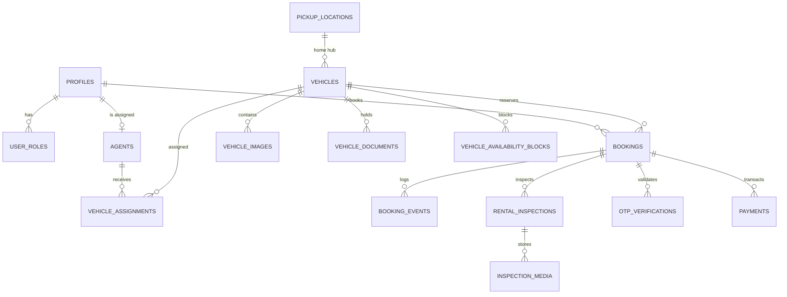

# Homie Drives — Database Schema Specification (Supabase PostgreSQL)

* **Status**: Architecture Specification (Implementation targeted for Phase 2)
* **Engine**: PostgreSQL 15+ (Supabase) with `btree_gist` extension for temporal exclusion constraints.

---

## 1. Entity-Relationship Overview



---

## 2. Table Definitions & PostgreSQL Data Models

### A. Authentication & Roles
```sql
-- Extends auth.users
CREATE TABLE public.profiles (
    id UUID PRIMARY KEY REFERENCES auth.users(id) ON DELETE CASCADE,
    full_name TEXT NOT NULL,
    phone_number TEXT UNIQUE NOT NULL,
    email TEXT UNIQUE NOT NULL,
    digilocker_dl_number TEXT,
    digilocker_verified BOOLEAN DEFAULT FALSE,
    digilocker_verified_at TIMESTAMPTZ,
    created_at TIMESTAMPTZ DEFAULT NOW(),
    updated_at TIMESTAMPTZ DEFAULT NOW()
);

CREATE TYPE user_role_type AS ENUM ('customer', 'agent', 'master_admin');

CREATE TABLE public.user_roles (
    id UUID PRIMARY KEY DEFAULT gen_random_uuid(),
    profile_id UUID NOT NULL REFERENCES public.profiles(id) ON DELETE CASCADE,
    role user_role_type NOT NULL DEFAULT 'customer',
    created_at TIMESTAMPTZ DEFAULT NOW(),
    UNIQUE (profile_id, role)
);
```

### B. Fleet & Operational Agents
```sql
CREATE TABLE public.pickup_locations (
    id UUID PRIMARY KEY DEFAULT gen_random_uuid(),
    name TEXT NOT NULL,
    slug TEXT UNIQUE NOT NULL,
    city TEXT NOT NULL DEFAULT 'Delhi NCR',
    address TEXT NOT NULL,
    latitude NUMERIC(10, 7) NOT NULL,
    longitude NUMERIC(10, 7) NOT NULL,
    is_active BOOLEAN DEFAULT TRUE,
    created_at TIMESTAMPTZ DEFAULT NOW()
);

CREATE TABLE public.agents (
    id UUID PRIMARY KEY DEFAULT gen_random_uuid(),
    profile_id UUID UNIQUE NOT NULL REFERENCES public.profiles(id) ON DELETE RESTRICT,
    hub_id UUID NOT NULL REFERENCES public.pickup_locations(id) ON DELETE RESTRICT,
    badge_number TEXT UNIQUE NOT NULL,
    is_active BOOLEAN DEFAULT TRUE,
    created_at TIMESTAMPTZ DEFAULT NOW()
);

CREATE TYPE vehicle_status_type AS ENUM ('active', 'maintenance', 'decommissioned');

CREATE TABLE public.vehicles (
    id UUID PRIMARY KEY DEFAULT gen_random_uuid(),
    hub_id UUID NOT NULL REFERENCES public.pickup_locations(id) ON DELETE RESTRICT,
    vin TEXT UNIQUE NOT NULL,
    registration_number TEXT UNIQUE NOT NULL,
    name TEXT NOT NULL,
    slug TEXT UNIQUE NOT NULL,
    brand TEXT NOT NULL,
    category TEXT NOT NULL,
    year INT NOT NULL,
    fuel_type TEXT NOT NULL, -- Petrol, Diesel, Electric, CNG, Hybrid
    transmission TEXT NOT NULL, -- Automatic, Manual
    seats INT NOT NULL,
    base_daily_price_inr INT NOT NULL,
    security_deposit_inr INT NOT NULL,
    odometer_km INT NOT NULL DEFAULT 0,
    operational_status vehicle_status_type NOT NULL DEFAULT 'active',
    is_available_for_booking BOOLEAN DEFAULT TRUE,
    created_at TIMESTAMPTZ DEFAULT NOW(),
    updated_at TIMESTAMPTZ DEFAULT NOW()
);

-- Preserves full agent allocation history
CREATE TABLE public.vehicle_assignments (
    id UUID PRIMARY KEY DEFAULT gen_random_uuid(),
    vehicle_id UUID NOT NULL REFERENCES public.vehicles(id) ON DELETE RESTRICT,
    agent_id UUID NOT NULL REFERENCES public.agents(id) ON DELETE RESTRICT,
    assigned_by UUID NOT NULL REFERENCES public.profiles(id) ON DELETE RESTRICT,
    assigned_at TIMESTAMPTZ DEFAULT NOW(),
    unassigned_at TIMESTAMPTZ,
    notes TEXT
);
```

### C. Concurrency-Safe Booking & Reservation Engine
```sql
CREATE EXTENSION IF NOT EXISTS btree_gist;

CREATE TYPE booking_status_type AS ENUM (
    'pending_pickup',
    'verified_handover',
    'active_rental',
    'returned_inspected',
    'closed',
    'cancelled'
);

CREATE TABLE public.bookings (
    id UUID PRIMARY KEY DEFAULT gen_random_uuid(),
    booking_code TEXT UNIQUE NOT NULL, -- e.g. HD-DEL-8924
    customer_id UUID NOT NULL REFERENCES public.profiles(id) ON DELETE RESTRICT,
    vehicle_id UUID NOT NULL REFERENCES public.vehicles(id) ON DELETE RESTRICT,
    pickup_hub_id UUID NOT NULL REFERENCES public.pickup_locations(id) ON DELETE RESTRICT,
    condition_tier TEXT NOT NULL CHECK (condition_tier IN ('pristine', 'mint', 'touring')),
    rental_period TSTZRANGE NOT NULL,
    pickup_time TIMESTAMPTZ NOT NULL,
    return_time TIMESTAMPTZ NOT NULL,
    daily_rate_inr INT NOT NULL,
    total_amount_inr INT NOT NULL,
    security_deposit_inr INT NOT NULL,
    damage_protection_tier TEXT NOT NULL DEFAULT 'standard',
    fastag_buffer_inr INT NOT NULL DEFAULT 0,
    status booking_status_type NOT NULL DEFAULT 'pending_pickup',
    pickup_otp_hash TEXT,
    created_at TIMESTAMPTZ DEFAULT NOW(),
    updated_at TIMESTAMPTZ DEFAULT NOW(),
    
    -- Concurrency Guard: Prevents overlapping bookings on the same vehicle
    EXCLUDE USING gist (vehicle_id WITH =, rental_period WITH &&)
    WHERE (status NOT IN ('cancelled', 'closed'))
);
```

### D. Inspections, Video Media & Audit Logs
```sql
CREATE TYPE inspection_type AS ENUM ('pre_handover', 'return');

CREATE TABLE public.rental_inspections (
    id UUID PRIMARY KEY DEFAULT gen_random_uuid(),
    booking_id UUID NOT NULL REFERENCES public.bookings(id) ON DELETE RESTRICT,
    agent_id UUID NOT NULL REFERENCES public.agents(id) ON DELETE RESTRICT,
    type inspection_type NOT NULL,
    odometer_reading INT NOT NULL,
    fuel_or_battery_percent INT NOT NULL,
    inspection_video_path TEXT NOT NULL, -- Supabase Private Storage Object Key
    passed_sanitization BOOLEAN DEFAULT TRUE,
    damage_notes TEXT,
    completed_at TIMESTAMPTZ DEFAULT NOW()
);

CREATE TABLE public.audit_logs (
    id UUID PRIMARY KEY DEFAULT gen_random_uuid(),
    actor_id UUID REFERENCES public.profiles(id),
    action TEXT NOT NULL,
    entity_name TEXT NOT NULL,
    entity_id UUID NOT NULL,
    payload JSONB,
    ip_address INET,
    created_at TIMESTAMPTZ DEFAULT NOW()
);
```

### E. Customer KYC, Digital Contracts & Escrow Settlements
```sql
CREATE TYPE kyc_status_type AS ENUM ('verified', 'pending_review', 'flagged', 'rejected');
CREATE TYPE kyc_risk_level_type AS ENUM ('low', 'medium', 'high');

CREATE TABLE public.customer_kyc (
    id UUID PRIMARY KEY DEFAULT gen_random_uuid(),
    user_id UUID REFERENCES public.profiles(id) ON DELETE CASCADE,
    full_name TEXT NOT NULL,
    phone TEXT NOT NULL,
    email TEXT NOT NULL,
    masked_aadhaar TEXT NOT NULL,
    dl_number TEXT NOT NULL,
    issuing_rto TEXT,
    vehicle_classes TEXT[] DEFAULT ARRAY['LMV-NT'],
    status kyc_status_type NOT NULL DEFAULT 'pending_review',
    risk_level kyc_risk_level_type NOT NULL DEFAULT 'low',
    review_notes TEXT,
    reviewed_by TEXT,
    reviewed_at TIMESTAMPTZ,
    document_url TEXT,
    verified_at TIMESTAMPTZ,
    created_at TIMESTAMPTZ DEFAULT NOW(),
    updated_at TIMESTAMPTZ DEFAULT NOW()
);

CREATE TYPE contract_status_type AS ENUM ('signed', 'countersigned', 'disputed', 'archived');

CREATE TABLE public.rental_contracts (
    id UUID PRIMARY KEY DEFAULT gen_random_uuid(),
    contract_number TEXT UNIQUE NOT NULL,
    booking_ref TEXT NOT NULL,
    customer_name TEXT NOT NULL,
    customer_email TEXT NOT NULL,
    customer_phone TEXT NOT NULL,
    masked_aadhaar TEXT NOT NULL,
    dl_number TEXT NOT NULL,
    vehicle_name TEXT NOT NULL,
    registration_number TEXT NOT NULL,
    hub_name TEXT NOT NULL,
    pickup_date DATE NOT NULL,
    return_date DATE NOT NULL,
    total_days INT NOT NULL,
    daily_rate_inr INT NOT NULL,
    deposit_held_inr INT NOT NULL,
    total_amount_inr INT NOT NULL,
    terms_version TEXT NOT NULL DEFAULT 'Homie-Master-Rental-Agreement-v2.4-NCR',
    customer_signature_svg TEXT NOT NULL,
    countersigned_by_admin BOOLEAN DEFAULT FALSE,
    admin_signature_svg TEXT,
    admin_signer_name TEXT,
    status contract_status_type NOT NULL DEFAULT 'signed',
    document_hash_sha256 TEXT NOT NULL,
    ip_address TEXT,
    signed_at TIMESTAMPTZ DEFAULT NOW(),
    countersigned_at TIMESTAMPTZ,
    created_at TIMESTAMPTZ DEFAULT NOW()
);

CREATE TYPE settlement_status_type AS ENUM (
    'held_in_escrow',
    'refund_dispatched',
    'disputed_hold',
    'settlement_pending'
);

CREATE TABLE public.settlements (
    id UUID PRIMARY KEY DEFAULT gen_random_uuid(),
    booking_ref TEXT UNIQUE NOT NULL,
    customer_name TEXT NOT NULL,
    customer_phone TEXT NOT NULL,
    customer_email TEXT NOT NULL,
    vehicle_name TEXT NOT NULL,
    vehicle_registration TEXT NOT NULL,
    hub_name TEXT NOT NULL,
    pickup_date TEXT NOT NULL,
    return_date TEXT NOT NULL,
    deposit_held_inr INT NOT NULL,
    fastag_tolls_inr INT NOT NULL DEFAULT 0,
    toll_plazas JSONB DEFAULT '[]'::jsonb,
    excess_km INT NOT NULL DEFAULT 0,
    excess_km_rate_inr INT NOT NULL DEFAULT 15,
    excess_km_charges_inr INT NOT NULL DEFAULT 0,
    damage_cleaning_charges_inr INT NOT NULL DEFAULT 0,
    damage_reason TEXT,
    total_deductions_inr INT NOT NULL DEFAULT 0,
    net_refund_inr INT NOT NULL DEFAULT 0,
    zero_floor_applied BOOLEAN DEFAULT FALSE,
    status settlement_status_type NOT NULL DEFAULT 'held_in_escrow',
    payment_gateway_ref TEXT,
    settled_at TIMESTAMPTZ,
    settled_by TEXT,
    settlement_notes TEXT,
    created_at TIMESTAMPTZ DEFAULT NOW()
);
```

---

## 3. Row Level Security (RLS) Policy Blueprint & Helper Functions
* **Helper Functions**:
  - `public.is_admin()`: Verifies if authenticated caller is a Master Administrator.
  - `public.is_agent()`: Verifies if authenticated caller is a certified operational Hub Agent.
  - `public.get_agent_hub_id()`: Resolves the active assigned pickup location hub for the calling agent.
* **Vehicles**: Anyone can view active vehicles (`operational_status = 'active'`). Hub agents can update odometer readings upon return. Only `master_admin` can insert or edit vehicles.
* **Bookings**: Customers can only view and create their own bookings (`customer_id = auth.uid()`). Agents can view and update bookings assigned to their hub. `master_admin` can view all bookings. Concurrency lock enforced via `EXCLUDE USING gist (vehicle_id WITH =, rental_period WITH &&)`.
* **KYC & Dossiers**: Customers can only upload and view their own identity records. Admins review and update verification status.
* **Contracts**: Signers view their executed contracts; admins review and countersign.
* **Settlements**: Customers view refund disbursements; Hub agents and Master Admin manage toll deductions and escrow release.
* **Storage**: 
  - `inspections`: Private bucket (50 MB limit) for 360° walkaround videos and return photos. Uploadable by agents and admins; viewable by authenticated users for their bookings.
  - `kyc-documents`: Private bucket (10 MB limit) for Driving License scans and masked Aadhaar PDFs. Isolated by `auth.uid() = foldername` with administrative review access.


