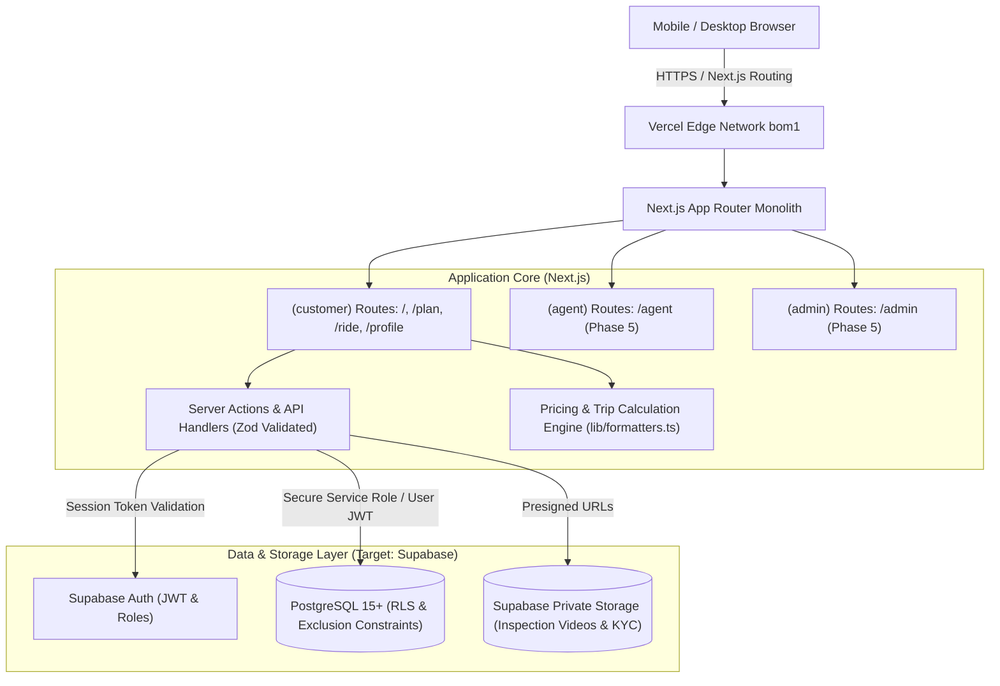

# Homie Drives — Technical Architecture Specification

* **Architecture Pattern**: Modular Monolith
* **Framework**: Next.js 16 (App Router), React 19, TypeScript (Strict Mode)
* **Hosting**: Vercel (Edge Network with Mumbai `bom1` primary POP)
* **Database & Auth (Target)**: Supabase PostgreSQL with Row Level Security (RLS)

---

## 1. System Architecture Overview



---

## 2. Target Repository Structure

```text
src/
├── app/
│   ├── (public)/                 # Landing & SEO marketing pages
│   ├── (customer)/               # Customer routes: /, /plan, /ride, /profile, /cars/[slug]
│   ├── (agent)/                  # Agent field portal: /agent (Phase 5)
│   ├── (admin)/                  # Master administration: /admin (Phase 5)
│   ├── api/                      # Protected server webhooks & integrations
│   ├── layout.tsx                # Global root layout & font provider
│   └── globals.css               # Design tokens, variables & utility classes
├── components/
│   ├── layout/                   # Navbar, BottomNav, Footer
│   ├── common/                   # Logo, DisclaimerBanner, StatPill
│   ├── cars/                     # CarCard, CarImageCarousel, CarConditionSelector, CarDetailView
│   ├── booking/                  # SearchPanel, ReservationModal (4-Step Drawer)
│   ├── plan/                     # TripsTab, CarsTab
│   └── ride/                     # BookTab, PassTab
├── features/                     # Domain modules (Phases 2-7)
│   ├── authentication/
│   ├── fleet/
│   ├── bookings/
│   ├── trip-planning/
│   └── inspections/
├── lib/
│   ├── supabase/                 # Client, Server, and Admin Supabase instances
│   ├── auth/                     # Session & role helpers
│   ├── formatters.ts             # Deterministic pricing & currency calculations
│   └── passStorage.ts            # Reactive local sync via useSyncExternalStore
├── types/
│   ├── car.ts                    # Vehicle specifications & condition tiers
│   └── booking.ts                # Reservation, passes, protection plans, trips
└── data/
    ├── cars.ts                   # Demo fleet inventory (10 models)
    ├── locations.ts              # Delhi NCR hubs
    └── trips.ts                  # Curated regional road trip itineraries
```

---

## 3. Technology Stack Justifications

| Component | Technology | Rationale |
| :--- | :--- | :--- |
| **Web Framework** | Next.js 16 (App Router) | High-performance server-side rendering, static page pre-generation (`generateStaticParams`), integrated routing, and zero-bundle server logic. |
| **Language** | TypeScript (Strict) | Compile-time type safety preventing runtime undefined failures across pricing breakdowns and fleet specifications. |
| **Styling** | Tailwind CSS v4 | Lightweight CSS utility generation matching Mobbin soft sage-green aesthetic without runtime CSS-in-JS overhead. |
| **Component Primitives** | shadcn/ui & Radix UI | Headless accessible primitives for drawers, modal dialogs, and radio cards. |
| **Database** | PostgreSQL via Supabase | Relational data integrity, native geospatial support (`PostGIS`), and exclusion constraints preventing double bookings. |
| **Authorization** | Row Level Security (RLS) | Database-enforced permission isolation ensuring agents only access assigned vehicles and customers only see their bookings. |
| **Media Storage** | Supabase Storage | Encrypted private buckets for driving license KYC and mandatory return inspection videos. |

---

## 4. Operational Boundaries & Telematics Rules
* **No Simulated Live GPS**: Live vehicle tracking requires real OBD-II / CAN-bus IoT hardware. In accordance with platform governance, if hardware is not installed, the platform explicitly displays `"GPS NOT CONNECTED"` rather than fabricating simulated map locations.
* **Client-to-Database Isolation**: Client components never import `SUPABASE_SERVICE_ROLE_KEY`. All database mutations flow through authenticated Server Actions or RLS-scoped user sessions.

